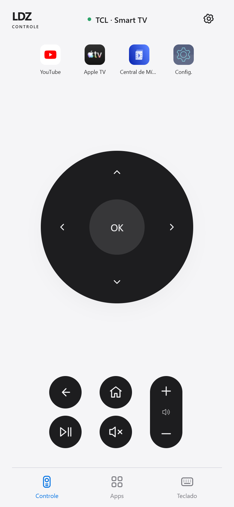
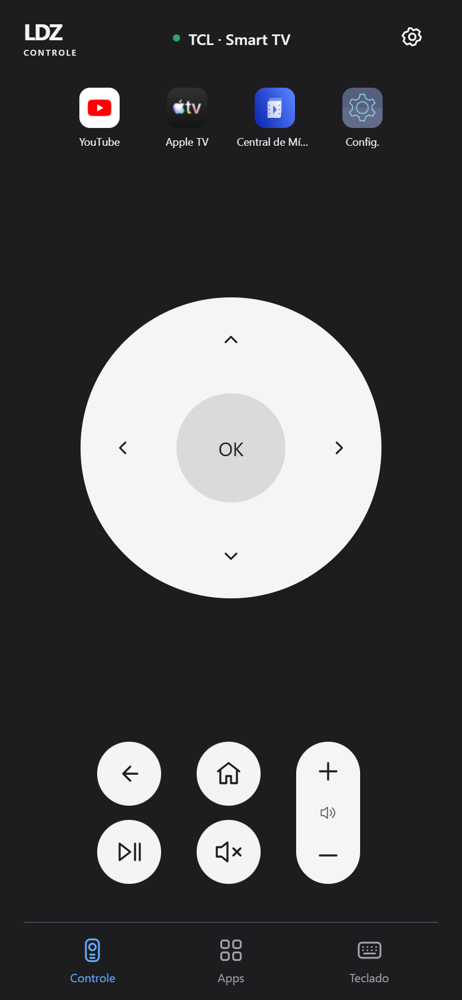

# Controle LDZ

Controle remoto local para Android TV e projetores Android. O aparelho executa um pequeno receptor e hospeda a interface no Wi-Fi; o celular abre a página pelo navegador, sem instalar um app no telefone e sem usar um servidor externo.

## Projetos relacionados

- [TV LDZ](https://github.com/ludezam/TV-LDZ) — launcher personalizado para Google TV e Android TV.
- [FreeMyProjector LDZ](https://github.com/ludezam/FreeMyProjector-LDZ) — home personalizada para projetores Android.

## Recursos

- Pareamento por QR code ou código curto exibidos na tela do aparelho.
- Setas e seleção, voltar, início, volume, mudo e controles de reprodução.
- Botão de energia centralizado com o direcional, a Home e o Mudo; pede confirmação antes de desligar e orienta a reabrir o app na TV após ligá-la.
- Abas para aplicativos instalados e teclado do celular, incluindo texto Unicode.
- Temas **Prateado** e **Meia-noite**, layout para retrato e paisagem, sem rolagem ou zoom acidental.
- Ícone e banner próprios para launchers de Android TV.
- Serviço em primeiro plano para manter o receptor disponível enquanto o aparelho está ligado.
- Verificação manual de novas versões do APK pelo GitHub, em **Configurações → Buscar atualizações**, com validação de tamanho, SHA-256, pacote e assinatura antes da instalação.

## Atualizações

O app consulta a release mais recente de [Controle LDZ no GitHub](https://github.com/ludezam/Controle-LDZ/releases/latest). A instalação requer confirmação do Android; na primeira atualização, pode ser necessário permitir que Controle LDZ instale apps desconhecidos nas configurações do sistema. O atualizador só aceita APKs assinados com a chave oficial e publicados na release.

## Capturas da interface

As imagens abaixo mostram a página de controle nos dois temas disponíveis:

| Prateado | Meia-noite |
|---|---|
|  |  |

## Como conectar

1. Instale e abra **Controle LDZ** na TV ou no projetor.
2. Conecte o celular à mesma rede Wi-Fi.
3. Leia o QR code mostrado pelo aparelho. Se preferir, abra no celular o endereço local exibido e digite o código de conexão.
4. Autorize o ADB local no aparelho quando solicitado.

O QR code e o código são específicos daquela sessão do receptor. Cada navegador guarda seu próprio pareamento. O endereço IP pode mudar quando o roteador atribuir outro IP ao aparelho.

## Compatibilidade e limitações

- APK: Android 8.0 ou superior.
- Instalação confirmada em uma TCL com Android 11 e em um projetor Android 12. Os comandos remotos foram exercitados na TCL; a validação completa do controle em Android 9 e em outros fabricantes continua pendente.
- Para enviar comandos de navegação, o aparelho precisa disponibilizar ADB autenticado localmente em `127.0.0.1:5555`. Ative a depuração e aceite a chave do Controle LDZ na tela do Android.
- A home personalizada pode manter uma faixa de favoritos separada do app drawer; instalar o Controle LDZ não o fixa automaticamente nessa faixa.
- O botão não liga um aparelho sem alimentação. Ele alterna a tecla de energia do Android para entrar ou sair do modo de espera; acordar pela rede depende de o Wi-Fi, o ADB e o receptor continuarem acessíveis.
- No teste da TV UnionTV com Android 9, o firmware encerrou o acesso Wi-Fi/ADB ao entrar em espera, mesmo com o serviço tentando manter CPU e Wi-Fi ativos. Nessa TV, é necessário usar o controle físico para acordá-la; outros aparelhos precisam ser validados individualmente.
- Para tentar manter o receptor alcançável em espera, o serviço mantém CPU e Wi-Fi ativos enquanto a tela está apagada, o que aumenta o consumo. Os bloqueios são liberados quando a tela acende ou o serviço é encerrado.

## Segurança e rede

O receptor fica disponível na rede local pela porta TCP 8765. A API exige pareamento, limita tentativas e aceita apenas uma lista fechada de comandos; não há endpoint de shell arbitrário. A interface usa HTTP local, sem TLS. Use uma rede de confiança e não encaminhe essa porta para a Internet.

## Compilar no Windows

Requisitos: PowerShell, JDK 17, Android SDK `platforms;android-34` e `build-tools;34.0.0`. Por padrão, o build usa `C:\Users\ludez\Documents\Codex\tools\android-build-tools` (Android SDK em `android-sdk` e JDK em `jdk`). Para outro local, configure `ANDROID_BUILD_TOOLS_ROOT`, ou configure `ANDROID_SDK_ROOT` e `JAVA_HOME`.

```powershell
$env:ANDROID_BUILD_TOOLS_ROOT = 'C:\Users\ludez\Documents\Codex\tools\android-build-tools'
.\build-apk.ps1
```

O script gera `outputs/Controle-LDZ-1.5.0.apk`, com o nome exigido pelo atualizador integrado. A dependência ZXing Core 3.5.3 e a licença Apache 2.0 estão em `libs/` e em `app/src/main/assets/licenses/`.

O keystore de desenvolvimento fica em `.android/` e não é publicado. Uma instalação existente só aceita atualizações assinadas com a mesma chave privada; preserve seu keystore e não o envie ao GitHub. Cada clone novo gera uma chave de desenvolvimento própria.

## Testes manuais

`tools/test_receiver.py` verifica pareamento, autenticação e a API contra um aparelho acessível na rede. Capture a hierarquia da tela de pareamento em `work/pairing-screen.xml` e execute:

```powershell
python tools/test_receiver.py --url http://IP_DO_APARELHO:8765
```

O teste salva o token local em `work/test-session.json`; a pasta `work/` é ignorada pelo Git. `tools/test_web.cjs` cobre tamanhos de tela, temas e toques; requer Node.js e Playwright.

## Licenças

Este repositório ainda não define uma licença de reutilização para o código Controle LDZ. O ZXing Core 3.5.3 é distribuído sob Apache License 2.0; veja [`THIRD_PARTY_NOTICES.md`](THIRD_PARTY_NOTICES.md) e `app/src/main/assets/licenses/`.

## Integração com TV LDZ

O **Controle LDZ 1.5.0** inclui a página **Personalizar** para TVs com [TV LDZ 2.2.0](https://github.com/ludezam/TV-LDZ/releases/tag/v2.2.0). Depois de parear o celular, ela permite ajustar o papel de parede, o desfoque, o protetor de tela e as fotos pela rede local.

Instale os APKs compatíveis nas respectivas páginas: [Controle LDZ 1.5.0](https://github.com/ludezam/Controle-LDZ/releases/tag/v1.5.0) e [TV LDZ 2.2.0](https://github.com/ludezam/TV-LDZ/releases/tag/v2.2.0). A ponte do TV LDZ restringe o acesso às opções de personalização solicitadas pelo pacote Controle LDZ.


